# 🌐 Awesome Centralized Cloud Data Repository

  

  
  
  
  
  
  

  <strong>🌟 Top Centralized Cloud Data Repositories, Data Lakehouses, Object Stores &amp; Catalogs 🌟</strong> 
  <em>A carefully curated landscape of enterprise SaaS platforms and battle-tested open-source projects.</em> 
  <strong>Last updated: October 2026</strong>

---

## 📖 Introduction &amp; Overview

This repository is an exhaustive, **SEO-optimized developer directory** and **architectural guide** tracking enterprise **SaaS platforms** and high-velocity **open-source GitHub projects** for **Centralized Cloud Data Repositories**.

These modern systems enable data platform teams, cloud architects, and data engineers to unify structured, semi-structured, and unstructured data across multi-cloud environments, distributed data lakes, and data warehouses. They deliver:
- 🗂️ **Unified Data Catalogs &amp; Active Metadata Management**: Single-pane discovery, automated schema classification, and automated indexing across heterogeneous sources.
- 🔐 **Centralized Governance &amp; Credential Vending**: Fine-grained access control (table-, column-, row-, and cell-level security), temporary data access tokens, and compliance auditing (HIPAA, GDPR, CCPA).
- 🧊 **Open Lakehouse Table Formats**: ACID transactions, schema evolution, and time travel over open object storage via formats like Apache Iceberg and Delta Lake.
- ⚡ **Zero-Copy Data Sharing**: Seamless cross-cloud and cross-account data federation without brittle ETL pipelines or expensive data replication.
- 🪣 **Scalable S3-Compatible Object Storage**: High-performance, geo-distributed blob storage layers.

---

## 📑 Table of Contents

- [📈 Sector Overview &amp; Market Dynamics](#-sector-overview--market-dynamics)
- [☁️ SaaS &amp; Hosted Platforms](#️-saas--hosted-platforms)
- [💻 Open-Source GitHub Projects](#-open-source-github-projects)
- [🤝 How to Contribute](#-how-to-contribute)
- [💖 Support &amp; Community](#-support--community)
- [⭐ Star History](#-star-history)
- [⚖️ Disclaimer &amp; Architecture Matrix](#️-disclaimer--architecture-matrix)

---

## 📈 Sector Overview &amp; Market Dynamics

The global data governance, metadata management, and centralized cloud data repository market is estimated at **$5.2 billion in 2024–2025** and is projected to expand to **over $16B–$22 billion by 2030** (CAGR ~20–22%). 

The sector exhibits **moderate fragmentation with concentrated enterprise anchor players**:
- **Enterprise Core Concentration**: Hyperscalers (Microsoft, Google Cloud, AWS) and data warehouse/lakehouse leaders (Databricks, Snowflake) dominate large enterprise production estates where integrated credential vending, native compute engines, and end-to-end security compliance are paramount.
- **Vibrant Open-Source &amp; Neutral Ecosystem**: Growing enterprise resistance to vendor lock-in has fueled strong adoption of open formats (**Apache Iceberg**, **Delta Lake**), independent REST catalogs (**Apache Polaris**, **Project Nessie**, **Lakekeeper**), and decoupled open-source metadata platforms (**OpenMetadata**, **DataHub**). This hybrid balance enables organizations to establish a unified data control plane across on-premises, multi-cloud, and hybrid environments.

---

## ☁️ SaaS &amp; Hosted Platforms

| 🏢 Product | 📊 Company Size (Valuation / Revenue) | 🏷️ Pricing (Starting Tier) | 🎁 Free Tier / Trial Limits | 🔍 Architecture &amp; Capabilities |
| :--- | :--- | :--- | :--- | :--- |
| **[Microsoft Purview](https://www.microsoft.com/en-us/security/business/microsoft-purview)** | **~$3.9 Trillion** market cap (Microsoft) | **Data Map Capacity Units: $0.411/CU/hour** (~$300/mo per 10 GB metadata &amp; 25 ops/sec); **Governed Assets: ~$0.50/asset/month** ($0.0165/day); **M365 Compliance add-on: $12/user/month** (or **$57/user/month** for full E5) | **Free tier includes up to 1,000 annotated assets forever** (curator API only); enterprise suite offers a **90-day free trial with 25 Microsoft Purview Suite licenses** | 🛡️ **Unified data governance, risk, and compliance** platform spanning M365, Azure, and multi-cloud sources. Provides unified data catalog, sensitivity labels, DLP, and Insider Risk Management—essential for securing Microsoft 365 Copilot against over-shared enterprise data. |
| **[Google Cloud Dataplex](https://cloud.google.com/dataplex)** | **~$3.4 Trillion** market cap (Alphabet) | **Standard Processing: $0.060/DCU-hr; Premium Processing: $0.089/DCU-hr; Enriched Metadata Storage: $0.20/GiB/month** | **First 100 DCU-hours/month of Standard Processing and first 1 MiB of enriched metadata storage are 100% free forever**; new GCP accounts receive **$300 credits for 90 days** | 🌐 **Intelligent data fabric** for unified analytics across distributed data. Introduces Lakes and Zones with policy propagation. Automated metadata discovery across BigQuery, Dataproc, and Cloud Storage, with automated sensitive data classification and data quality checks. |
| **[AWS Lake Formation](https://aws.amazon.com/lake-formation/)** | **~$2.7 Trillion** market cap (Amazon) | **Governance policies: $0.00** (Lake Formation Storage API: **$2.25 per TB scanned** with 10 MB minimum per query; Glue Catalog beyond free tier: **$1.00 per 100,000 objects/month** and **$1.00 per 1M requests**) | **Glue Data Catalog includes 1,000,000 free objects &amp; 1,000,000 free requests per month forever**; standard AWS 12-month free tier (5 GB S3) applies | 🔒 **Data lake governance** built on AWS Glue Data Catalog. Centralizes permissions across Amazon S3, Athena, EMR, Redshift Spectrum, and other AWS analytics engines with cell-, row-, and column-level security. |
| **[Databricks Unity Catalog](https://www.databricks.com/)** | **$190 Billion** valuation / **$7B+ ARR** run-rate (Databricks) | **Jobs Classic: $0.15/DBU; All-Purpose Classic: $0.55/DBU; Serverless SQL: $0.70/DBU** (Premium tier on AWS/Azure) | **14-day free trial with up to $400 in usage credits** (or forever-free Community Edition limited to serverless micro-clusters with daily compute quotas) | 🚀 **Unified governance layer for data and AI** across the lakehouse. Managing **~100M tables, ~550k volumes, and ~400k ML models** for ~9,000 customers, serving ~60,000 API calls/sec. Three-level namespace (`catalog.schema.object`), credential vending, catalog federation, Delta UniForm, and audit log system tables. |
| **[Snowflake Secure Data Sharing](https://www.snowflake.com/)** | **~$115 Billion** market cap / **$3.6B+ ARR** (Snowflake) | **Standard Edition: $2.00/credit; Enterprise Edition: $3.00/credit; Storage: $23/TB/month** | **30-day free trial with $400 in free usage credits** | ❄️ **Cross-account data sharing without copying** using Snowflake's services layer and metadata store. Zero data replication—shared objects are read-only, consumers pay only compute to query. Supports reader accounts for non-Snowflake consumers. Multi-cluster, shared-data architecture. |
| **[Cloudera Shared Data Experience (SDX)](https://www.cloudera.com/)** | **$5.3 Billion** PE buyout valuation / **~$1.0B ARR** (Cloudera) | **CDP Public Cloud: starts at $0.04/CCU-hr** (Data Hub) to **$0.054-$0.07/CCU-hr** (Data Warehouse); **CDP Private Cloud starts at ~$10,000/node/year** (or **$400/CCU/year**) | **60-day free trial of CDP Private Cloud Base / Data Science Workbench** with no license key required | 🏢 **Unified data access and governance** across Cloudera environments. Integrates Apache Ranger, Apache Atlas, Trino, and Octopai Data Lineage to provide a single secure endpoint for enterprise data across multi-cloud and on-premises environments without policy replication. |
| **[Dremio Arctic](https://www.dremio.com/)** | **$2.0 Billion** valuation / **~$100M ARR** (Dremio) | **Dremio Cloud: $0.20 per DCU-hour** (Extra Small engine at 32 DCUs = **$6.40/hr**; Small at 64 DCUs = **$12.80/hr**) | **Dremio Cloud Forever-Free Standard Tier** (capped engine sizes, Community support) and **Dremio Community Edition (forever-free self-hosted software)** | ⚡ **Data lakehouse management service** with Git-like operations for Apache Iceberg catalogs. Powered by open-source Project Nessie, providing instant branching, zero-copy commits, and rollbacks for Iceberg tables across Spark, Flink, and Dremio Sonar. |

---

## 💻 Open-Source GitHub Projects

Below are the most prominent open-source repositories powering modern decentralized and centralized data repositories, sorted by **GitHub Stars_Count (descending)**:

- **[MinIO](https://github.com/minio/minio)** 
  
  🪣 **High-performance, S3-compatible object storage** (AGPL-3.0) — **the most widely deployed open-source object storage server** for cloud-native data repositories.
  - **Features**: Fully S3-compatible API—works with existing SDKs, tools, and automation; erasure coding and bitrot protection for enterprise data reliability; distributed horizontal scaling; TLS/HTTPS encryption with access keys and LDAP/AD integration; single binary deployment on Linux, Docker, Kubernetes; built-in web console.
  - **Tech stack**: Go • **Deploy**: Self-hosted (binary, Docker, Kubernetes).
  - **Trade-off**: Object storage only—provides buckets, not a data catalog, governance layer, or table format. It is the storage foundation that catalogs manage.
  - **Best for**: Teams wanting a self-hosted, S3-compatible object store as the foundation for a data lake—without cloud S3 egress costs or vendor lock-in.

- **[OpenMetadata](https://github.com/open-metadata/OpenMetadata)** 
  
  🌐 **Unified metadata platform for data discovery, governance, and quality** (Apache 2.0) — **a modern, open-standard data catalog**.
  - **Features**: Centralized metadata ingestion via 80+ connectors (warehouses, lakes, BI, pipelines); automated column-level data lineage; data quality profiler and native test assertions; data contracts; role-based access control and team collaboration workflows; schema registry.
  - **Tech stack**: Java, TypeScript, Python • **Deploy**: Docker, Kubernetes, Helm.
  - **Trade-off**: Metadata management and catalog layer—does not store underlying data files or execute heavy analytics queries directly.
  - **Best for**: Organizations needing an end-to-end open-source catalog, lineage, and discovery layer across their entire heterogeneous data ecosystem.

- **[DataHub](https://github.com/datahub-project/datahub)** 
  
  🔍 **Extensible metadata platform for modern data discovery and governance** (Apache 2.0) — **LinkedIn's open-sourced enterprise metadata catalog**.
  - **Features**: Real-time push and pull metadata streaming using Kafka and GraphQL; end-to-end dataset and column-level lineage; data observability and assertions; automated impact analysis; tag/glossary governance; fine-grained access policies.
  - **Tech stack**: Java, Python, React • **Deploy**: Kubernetes, Docker Compose.
  - **Trade-off**: Requires dedicated infrastructure (Kafka, Elasticsearch/OpenSearch, MySQL/Postgres) to run at scale.
  - **Best for**: Enterprise engineering teams operating complex, high-velocity data pipelines wanting streaming metadata updates and real-time governance.

- **[Apache Iceberg](https://github.com/apache/iceberg)** 
  
  🧊 **Open table format for huge analytic tables** (Apache 2.0) — **the de facto standard for open lakehouse table storage**, enabling engines like Spark, Trino, Flink, and Snowflake to safely work with the same tables concurrently.
  - **Features**: Hidden partitioning and partition evolution without rewriting data; snapshot isolation with ACID guarantees; schema evolution (add, drop, rename, reorder columns); time travel queries; supports Parquet, ORC, and Avro file formats.
  - **Tech stack**: Java (core), Python • **Deploy**: Integrated with compute engines; catalogs provided separately (Polaris, Nessie, HMS).
  - **Trade-off**: Table format specification, not a catalog or storage layer—it defines how tables are structured; you still need a catalog (Polaris/Nessie) and storage (S3/MinIO).
  - **Best for**: Organizations building open lakehouse architectures wanting vendor-neutral table storage that multiple engines can access simultaneously—the foundation of any open centralized data repository.

- **[Delta Lake](https://github.com/delta-io/delta)** 
  
  ⚡ **Open-source storage framework for lakehouse architectures** (Apache 2.0) — **high-performance ACID table format natively optimized for Apache Spark**.
  - **Features**: ACID transactions with serializable isolation levels; scalable metadata handling using Spark; time travel data versioning; schema enforcement and evolution; unified streaming and batch data processing; UniForm (Universal Format) support for Iceberg and Hudi compatibility.
  - **Tech stack**: Scala, Java, Python, Rust • **Deploy**: Integrated as Spark / engine library.
  - **Trade-off**: Table format specification; relies on underlying object storage (MinIO/S3) and metastores (Hive Metastore / Unity Catalog).
  - **Best for**: Spark-centric organizations building data lakes requiring unified batch and streaming data ingestion with robust transactional safety.

- **[Apache Hudi](https://github.com/apache/hudi)** 
  
  🔄 **Streaming data lake platform with transactional upserts and CDC** (Apache 2.0) — **purpose-built for streaming ingestion and fast updates on object storage**.
  - **Features**: Fast record-level upserts and deletes; built-in change data capture (CDC) and incremental processing; timeline service managing atomic commits; file sizing optimizations and indexing; Copy-on-Write (CoW) and Merge-on-Read (MoR) storage layouts.
  - **Tech stack**: Java • **Deploy**: Integrated with compute engines (Spark, Flink, Trino, Presto).
  - **Trade-off**: Complex tuning parameters and configurations; focused on ingest/streaming table semantics rather than standalone metadata cataloging.
  - **Best for**: Teams running continuous, near-real-time CDC pipelines and frequent row-level updates on data lakes.

- **[Amundsen](https://github.com/amundsen-io/amundsen)** 
  
  🔎 **Data discovery and metadata engine** (Apache 2.0) — **originally created by Lyft to index and organize data assets across teams**.
  - **Features**: PageRank-style search algorithm for data discovery; automated metadata extraction from warehouses (Snowflake, BigQuery, Redshift, Hive); dataset previews and column profiling; frequent user / usage tracking; integrations with Apache Atlas and Neo4j.
  - **Tech stack**: Python, TypeScript • **Deploy**: Docker, Kubernetes.
  - **Trade-off**: Graph/metadata indexer; less focused on automated compliance/DLP enforcement compared to modern governance suites.
  - **Best for**: Data teams looking for self-service search and discovery across scattered data warehouses and lakehouse tables.

- **[Apache Gravitino](https://github.com/apache/gravitino)** 
  
  🌌 **Open data catalog for building high-performance, geo-distributed, federated metadata lakes** (Apache 2.0) — **the most ambitious open-source catalog project** in scope, supporting multiple metadata sources.
  - **Features**: Federated metadata across Hive, Iceberg, Hudi, Kafka, and relational databases; geo-distributed architecture; unified API for metadata access; supports multiple table formats and fine-grained access control.
  - **Tech stack**: Java • **Deploy**: Self-hosted.
  - **Trade-off**: Catalog federation, not storage or query—unifies metadata from existing catalogs rather than replacing underlying storage.
  - **Best for**: Organizations with heterogeneous metadata sources wanting a federated catalog layer without migrating everything to one format.

- **[Apache Polaris](https://github.com/apache/polaris)** 
  
  🧭 **Interoperable open-source catalog for Apache Iceberg** (Apache 2.0) — **the leading open catalog implementation** for multi-engine Iceberg access.
  - **Features**: Iceberg REST Catalog interface; credential vending for secure direct object storage access; supports multiple compute engines (Spark, Trino, Flink, Dremio); role-based access control; designed for complete interoperability and vendor neutrality.
  - **Tech stack**: Java • **Deploy**: Self-hosted.
  - **Trade-off**: Catalog only—manages Iceberg table metadata and access; relies on external storage (MinIO/S3) and query engines.
  - **Best for**: Teams wanting an open, vendor-neutral Iceberg catalog that multiple engines can share—the open-source alternative to proprietary catalog lock-in.

- **[Lakekeeper](https://github.com/lakekeeper/lakekeeper)** 
  
  🦀 **High-performance Iceberg REST Catalog in Rust** (Apache 2.0) — **lightweight, blazingly fast catalog implementation** built on `iceberg-rust`.
  - **Features**: Native Iceberg REST Catalog implementation; built-in access control and credential vending for AWS S3, Azure Blob, and GCP; OpenID Connect authentication; audit logging; minimal CPU/memory footprint.
  - **Tech stack**: Rust • **Deploy**: Docker, Kubernetes, single binary.
  - **Trade-off**: Focused strictly on the Iceberg REST specification; younger ecosystem than Java-based Polaris.
  - **Best for**: Teams wanting ultra-lightweight, high-throughput Iceberg catalog infrastructure without JVM overhead.

- **[Project Nessie](https://github.com/projectnessie/nessie)** 
  
  🌳 **Transactional catalog for data lakes with Git-like semantics** (Apache 2.0) — **the open-source foundation behind Dremio Arctic**.
  - **Features**: Git-like branching, commits, merges, and tags for Iceberg tables; snapshot isolation for concurrent writes; version control for data experiments and rollback; supports multiple table formats; Iceberg REST Catalog compatibility.
  - **Tech stack**: Java • **Deploy**: Self-hosted.
  - **Trade-off**: Catalog with versioning focus—adds Git-like workflows on top of Iceberg; not a compliance governance platform with fine-grained DLP.
  - **Best for**: Data teams wanting version-controlled Iceberg catalogs for experimentation, rollback, and data audit.

- **[Apache Amoro](https://github.com/apache/amoro)** 
  
  ⚙️ **Lakehouse management system on open table formats** (Apache 2.0) — **automated optimization and management layer for Iceberg and Mixed formats**.
  - **Features**: Automated self-optimizing compaction, sorting, and cleaning for lakehouse tables; asynchronous data maintenance without blocking queries; unified management across real-time and batch pipelines; multi-engine support.
  - **Tech stack**: Java • **Deploy**: Docker, Kubernetes.
  - **Trade-off**: Management and optimization layer—works alongside table formats and catalogs rather than functioning as a standalone metadata repository.
  - **Best for**: Platform teams needing hands-off background compaction and lifecycle optimization for high-churn lakehouse tables.

- **[LinkedIn OpenHouse](https://github.com/linkedin/openhouse)** 
  
  🏠 **Open control plane for tables in the data lakehouse** (Apache 2.0) — **LinkedIn's production control plane for Iceberg tables**.
  - **Features**: Table lifecycle management (create, delete, optimize); declarative table management policies; automated retention and data layout optimization; built for managing Iceberg tables at massive enterprise scale.
  - **Tech stack**: Java • **Deploy**: Self-hosted.
  - **Trade-off**: Control plane for Iceberg table operations; smaller community adoption outside LinkedIn.
  - **Best for**: Organizations running Iceberg at scale wanting a proven declarative control plane for table lifecycle operations.

🛠️ **Frameworks for building custom systems**: Combine **MinIO** as S3-compatible storage with **Apache Iceberg** or **Delta Lake** as the table format, **Apache Polaris**, **Project Nessie**, or **Lakekeeper** as the catalog, **OpenMetadata** or **DataHub** for end-to-end data discovery and governance, and **Apache Gravitino** for federated metadata—creating a fully open-source, vendor-neutral centralized data repository.

---

## 🤝 How to Contribute

Contributions are warmly welcomed! Please follow these steps to add or update projects:

1. 🍴 **Fork the repo** to your GitHub account.
2. 🌿 **Create a branch** for your feature or update: `git checkout -b feature/add-new-tool`.
3. 📝 **Add or edit entries in `README.md`**:
   - Ensure factual accuracy and link directly to official documentation or code repositories.
   - For SaaS products: provide transparent, verified starting-tier pricing and exact free trial / free tier limits.
   - For Open-Source projects: provide the repository link, Stars_Badge, license, core capabilities, tech stack, and architectural trade-offs.
4. 🚀 **Submit a Pull Request (PR)** with a clear title and brief rationale.

🌟 **Star the repository** if you find this landscape helpful for your data engineering journey!

---

## 💖 Support &amp; Community

If this repository has saved you time, simplified your data platform research, or contributed to your lakehouse architecture, please consider supporting the project:

- ⭐ **Star this repository** to help others discover it across GitHub.
- 🍴 **Fork and share** with your data engineering teammates and platform communities.
- ☕ **Buy me a coffee / Sponsor**: Support ongoing maintenance and curation via the [GitHub Sponsors Dashboard](https://github.com/sponsors/ishandutta2007).

---

## 📊 Star History

---

## ⚖️ Disclaimer &amp; Architecture Matrix

- 🛡️ This is a **community-curated list** — not exhaustive and not a commercial endorsement.
- 🔐 Centralized data repository platforms handling enterprise data must comply with international privacy regulations (GDPR, CCPA, HIPAA, SOC 2) and implement strict access controls, encryption, and audit logging.
- 🧩 **Architectural Taxonomy**:
  - **Governance Platforms** (*Databricks Unity Catalog, Snowflake Secure Data Sharing, AWS Lake Formation, Google Cloud Dataplex, Microsoft Purview, Cloudera SDX, Dremio Arctic*): Combine catalogs, policy engines, credential vending, and compute integrations.
  - **Catalogs &amp; Control Planes** (*Apache Polaris, Project Nessie, Apache Gravitino, LinkedIn OpenHouse, Lakekeeper*): Manage table metadata, schema evolution, and access contracts, relying on external object stores and query engines.
  - **Object Storage** (*MinIO*): Delivers durable, S3-compatible data block/bucket storage without built-in table semantics or governance.
  - **Open Table Formats** (*Apache Iceberg, Delta Lake, Apache Hudi*): Define on-disk transactional file manifests, partition schemes, and ACID commit logs over Parquet/ORC data.

---

  <strong>Crafted with ❤️ for data engineers, platform architects, and open data lakehouse builders worldwide.</strong>

